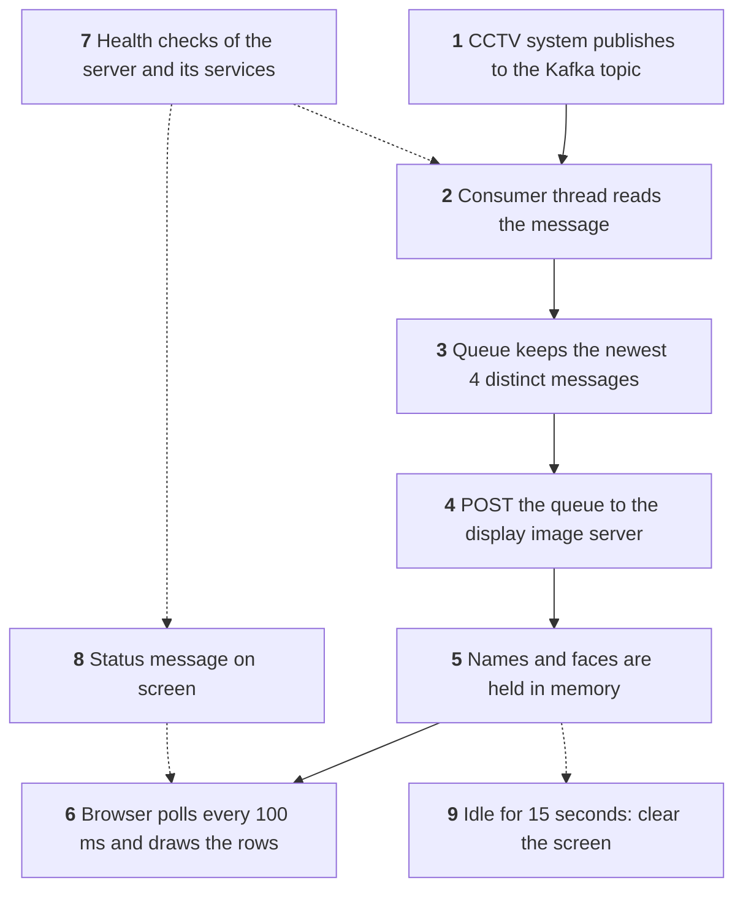
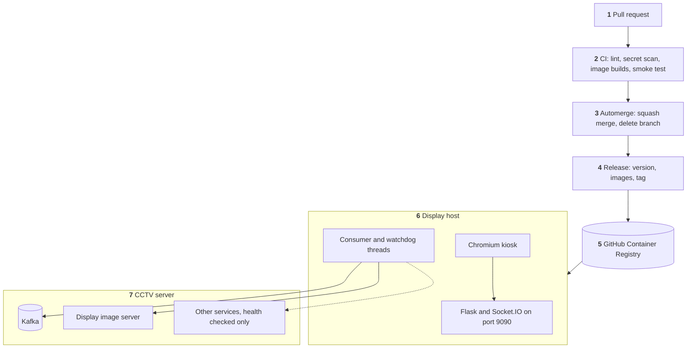

# Kafka-WebApp

Kafka-WebApp is the live display for the CCTV Face Recognition Attendance System. It reads recognition messages from Kafka, fetches each person's face image, and shows the latest person IDs and faces on a screen at the attendance point. When the system or the network is down, the screen says so.

## Quick start

Each release publishes `ghcr.io/hamza-aziz-ai/kafka-webapp:<tag>` for amd64 and arm64 (Raspberry Pi).

```bash
docker run -d --restart unless-stopped -p 9090:9090 -e IP_ADDRESS=<server-ip> ghcr.io/hamza-aziz-ai/kafka-webapp:<tag>
```

Then open `http://<host>:9090`.

| Variable | Default | Meaning |
|---|---|---|
| `IP_ADDRESS` | `192.168.12.1` | Server that runs Kafka and the display image server |
| `KAFKA_TOPIC` | `maingate_entry` | Topic to display. The Kafka consumer group is `<topic>.display` |
| `KAFKA_PARTITIONS` | every partition of the topic | Comma-separated partitions to show, for one screen per camera. Partition = camera number - 1, so `0,3` shows cameras 1 and 4. Anything but whole numbers stops the app at startup |
| `IMAGE_SERVER_ADDRESS` | `http://<IP_ADDRESS>:20013/post_images` | Display image server. On a central host, set this to the server of this display's own client, or the display would show another client's faces |
| `KAFKA_USERNAME` | not set | Kafka login. Setting it turns on SASL with `SCRAM-SHA-512`. Without it the app connects with no login |
| `KAFKA_PASSWORD` | not set | Password for `KAFKA_USERNAME`, required with it. Pass it as a secret, and never commit it |
| `KAFKA_SECURITY_PROTOCOL` | `SASL_PLAINTEXT` with a username, otherwise `PLAINTEXT` | Kafka security protocol. `SASL_PLAINTEXT` logs in but does not encrypt, so it is for a trusted network |
| `HOST_CHECK_PORT` | `22` | Port that shows the server is reachable |
| `PROJECT_SERVICES` | not set | Comma-separated `host:port` or bare port entries that must answer before consuming starts. A bare port means `IP_ADDRESS`. Use it for services not published on the host, such as `9092,display-image-server:20013`, or to add ports, such as a host running face liveness detection. A malformed entry stops the app at startup |
| `PROJECT_SERVICES_PORT` | the list in `parameters.py` | Comma-separated ports on `IP_ADDRESS` to check when `PROJECT_SERVICES` is not set |
| `SECRET_KEY` | random at each start | Flask session key |

To run on a Raspberry Pi without Docker, follow [docs/SETUP-RASPBERRY-PI.md](docs/SETUP-RASPBERRY-PI.md).

PR titles must be Conventional Commits: `feat:` gives a minor release, `fix:`/`perf:` a patch, and `type!:` a major.

## System Design

What happens to one recognition message. Solid arrows are the path every message takes; dotted arrows run on the side.



1. **Publish.** The CCTV system writes each recognised person's ID to the topic set by `KAFKA_TOPIC`, with the camera name as the key.
2. **Read.** A background thread reads every camera at the entry point, because each camera has its own partition, or only those in `KAFKA_PARTITIONS`. It starts from the end of the topic, so a restart shows new recognitions and never replays old ones. It checks for newly added cameras every 60 seconds.
3. **Queue.** The app keeps up to 4 distinct messages, newest first. Duplicates are dropped on purpose, so one person seen by several cameras shows once. A camera's `ERROR` or `SUCCESS` control message skips the queue and goes to the status strip instead (step 8).
4. **Fetch images.** The queue goes to the display image server, which returns each person's face image, or a placeholder if it has none. The call times out after 5 seconds, so a hung server cannot freeze the display.
5. **Hold.** The result stays in memory only. This app does not write IDs or faces to disk.
6. **Show.** The page asks for the current rows every 100 ms over Socket.IO and draws them.
7. **Check health.** Every pass of the loop checks TCP ports, first the host, then each service in `PROJECT_SERVICES`, or in `PROJECT_SERVICES_PORT` if that is not set. It needs 10 failures in a row before it reacts, so a brief drop shows nothing.
8. **Report status.** An outage puts a red message on screen, and recovery puts a green one. A camera problem shows as a red line in a strip at the top of the screen until that camera recovers, then as a green line for 5 seconds. It never hides the rows. After a services outage, the display waits 2 minutes for the system to finish starting before it reads Kafka again.
9. **Clear.** After 15 seconds with no update, the screen is cleared so that old rows do not linger.

Each flow is traced step by step in [docs/FLOW.md](docs/FLOW.md).

## Solution Architecture

How the code becomes the live system.



1. **Pull request.** The title sets the release type, because squash merges make it the commit subject.
2. **CI.** Runs ruff, gitleaks, amd64 and arm64 image builds, and a smoke test that dependencies resolve and settings load. It does not test app behaviour yet.
3. **Automerge.** Green CI is the merge gate. Automerge squash-merges any non-draft PR from this repo and deletes its branch.
4. **Release.** Picks the version from the merged titles, reruns CI on the merged commit, pushes images, then tags. `docs:` PRs merge without a release.
5. **Registry.** Images carry version tags only, and there is no `latest`.
6. **Display host.** An operator runs the new tag; nothing deploys automatically. The app runs as a non-root user, and a kiosk browser shows the page.
7. **CCTV server.** The app calls only Kafka and the display image server. It checks the other services' ports so that the screen can say the whole system is down.

What exists and who owns it is in [docs/ARCHITECTURE.md](docs/ARCHITECTURE.md).

## Documentation

| Document | What it covers |
|---|---|
| [docs/FLOW.md](docs/FLOW.md) | Detailed system design: how execution travels |
| [docs/ARCHITECTURE.md](docs/ARCHITECTURE.md) | Detailed solution architecture: modules, topology, ownership |
| [docs/DATA.md](docs/DATA.md) | Data structures and why they fit |
| [docs/DECISIONS.md](docs/DECISIONS.md) | What was chosen and why |
| [docs/ALTERNATIVES.md](docs/ALTERNATIVES.md) | What was rejected and why |
| [docs/THREAT.md](docs/THREAT.md) | Who could abuse it and what stops them |
| [docs/FAILURE.md](docs/FAILURE.md) | Where it breaks and how you would notice |
| [docs/TESTING.md](docs/TESTING.md) | How changes are verified |
| [docs/ROLLBACK.md](docs/ROLLBACK.md) | How to undo a change |
| [docs/CONSTRAINTS.md](docs/CONSTRAINTS.md) | Rules for anyone changing this repo, including AI tools |
| [docs/HANDOVER.md](docs/HANDOVER.md) | Where things stand right now |
| [docs/SETUP-RASPBERRY-PI.md](docs/SETUP-RASPBERRY-PI.md) | Raspberry Pi setup without Docker |
| [Configure-Parameters-for-Raspberry.md](Configure-Parameters-for-Raspberry.md) | Raspberry Pi parameter reference |

## Known limitations

- There is no auth on the page or socket, and any origin can connect, so anyone who can reach port 9090 can see person IDs and faces. Keep the port on a trusted network.
- It runs on the Flask development server.
- There are no behaviour tests yet. CI proves the image builds and starts, not that the display works.
- Nothing alerts on failure. Problems show on the screen or in `logs/`.
- A kiosk needs internet access when the page loads, because `socket.io.js` comes from a CDN.
- Camera status lines are held in memory and cleared when the consumer is rebuilt, so they rely on the CCTV system re-sending `ERROR` while a problem lasts.
