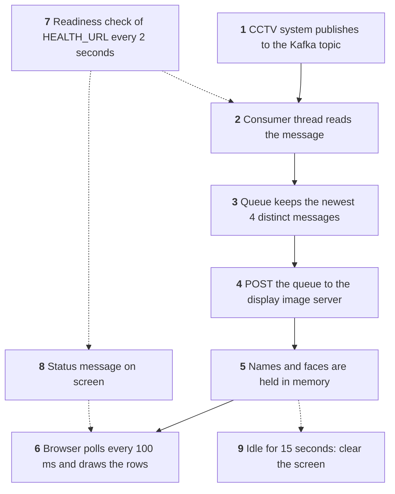
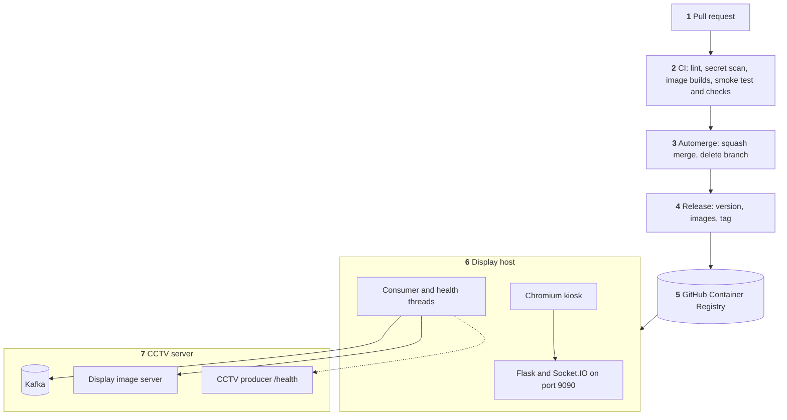

<div align="center">

# 🎥 Kafka-WebApp

### Live attendance display for the CCTV Face Recognition Attendance System

Shows who was just recognised at the attendance point, with their ID, name and face, and says clearly when the system is not ready.

[](https://github.com/hamza-aziz-ai/Kafka-WebApp/actions/workflows/ci.yml)
[](https://github.com/hamza-aziz-ai/Kafka-WebApp/actions/workflows/release.yml)
[](https://github.com/hamza-aziz-ai/Kafka-WebApp/tags)


[Quick start](#-quick-start) · [Configuration](#%EF%B8%8F-configuration) · [What the screen shows](#%EF%B8%8F-what-the-screen-shows) · [System design](#-system-design) · [Solution architecture](#%EF%B8%8F-solution-architecture) · [Docs](#-documentation)

</div>

---

## ✨ At a glance

| | |
|---|---|
| ⚡ **Real time** | Reads recognitions from Kafka as they arrive; the screen refreshes every 100 ms. |
| 🧑 **Four people on screen** | The newest top left, the rest gliding clockwise. One person seen by several cameras shows once. |
| 🚦 **Honest status** | Never says `Ready for the next person` while the system is down, starting or out of reach, not even for a moment. |
| 🔄 **Refresh safe** | A page refresh never loses a status or its remaining time. |
| 📷 **Camera alerts** | A camera problem scrolls as a chip along the bottom without hiding anyone. |
| 🔒 **Nothing on disk** | IDs, names and faces are held in memory only. |
| 📦 **Runs anywhere** | One image for servers (amd64) and Raspberry Pi (arm64), running as a non-root user. |

## 🚀 Quick start

Each release publishes `ghcr.io/hamza-aziz-ai/kafka-webapp:<tag>` for amd64 and arm64.

```bash
docker run -d --restart unless-stopped -p 9090:9090 -e IP_ADDRESS=<server-ip> ghcr.io/hamza-aziz-ai/kafka-webapp:<tag>
```

Then open **`http://<host>:9090`**.

> [!TIP]
> To run on a Raspberry Pi without Docker, follow [docs/SETUP-RASPBERRY-PI.md](docs/SETUP-RASPBERRY-PI.md). A Pi must set `IP_ADDRESS`.

## ⚙️ Configuration

| Variable | Default | Meaning |
|---|---|---|
| `IP_ADDRESS` | `127.0.0.1` | Server that runs Kafka and the display image server. The default only suits running directly on that server: in a container `127.0.0.1` is the container itself, so always set this with Docker, and on a Raspberry Pi |
| `KAFKA_TOPIC` | `maingate_entry` | Topic to display. The Kafka consumer group is `<topic>.display` |
| `KAFKA_PARTITIONS` | every partition of the topic | Comma-separated partitions to show, for one screen per camera. Partition = camera number - 1, so `0,3` shows cameras 1 and 4. Anything but whole numbers stops the app at startup |
| `IMAGE_SERVER_ADDRESS` | `http://<IP_ADDRESS>:20013/post_images` | Display image server. On a central host, set this to the server of this display's own client, or the display would show another client's faces |
| `HEALTH_URL` | `http://<IP_ADDRESS>:20010/health` | Readiness of the attendance system, served by the CCTV producer. In the CCTV stack, `http://mfr-cctv-producer-consumer:20010/health`; outside it, as on a Raspberry Pi, `https://<site host>/health` through the proxy. Anything but an `http` or `https` URL stops the app at startup |
| `KAFKA_USERNAME` | not set | Kafka login. Setting it turns on SASL with `SCRAM-SHA-512`. Without it the app connects with no login |
| `KAFKA_PASSWORD` | not set | Password for `KAFKA_USERNAME`, required with it. Pass it as a secret, and never commit it |
| `KAFKA_SECURITY_PROTOCOL` | `SASL_PLAINTEXT` with a username, otherwise `PLAINTEXT` | Kafka security protocol. `SASL_PLAINTEXT` logs in but does not encrypt, so it is for a trusted network |
| `SECRET_KEY` | random at each start | Flask session key |

## 🖥️ What the screen shows

| State | On screen |
|---|---|
| 🟢 Ready, someone recognised | Up to 4 cards with ID, name and face, newest top left |
| ⚪ Ready, nobody to show | A face guide: `Ready for the next person` |
| 🟢 Starting | Green panel: `Getting Started. Please Wait` |
| 🟢 Recovered | Green panel for 5 seconds: `Has Been Started. Please Resume Attendance` |
| 🔴 Unready | Red panel: `Temporarily Down` |
| 🔴 No answer, or Kafka out of reach | Red panel: `Cannot Reach the Facial Recognition Attendance System` |
| 🟠 Camera problem | Amber chip in the bottom marquee until the camera recovers, then green for 5 seconds |

## 🧭 System Design

What happens to one recognition message. Solid arrows are the path every message takes; dotted arrows run on the side.



<details>
<summary><b>Step by step</b></summary>

1. **Publish.** The CCTV system writes each recognised person's ID to the topic set by `KAFKA_TOPIC`, with the camera name as the key.
2. **Read.** A background thread reads every camera at the entry point, because each camera has its own partition, or only those in `KAFKA_PARTITIONS`. It starts from the end of the topic, so a restart shows new recognitions and never replays old ones. It checks for newly added cameras every 60 seconds.
3. **Queue.** The app keeps up to 4 distinct messages, newest first. Duplicates are dropped on purpose, so one person seen by several cameras shows once. A camera's `ERROR` or `SUCCESS` control message skips the queue and goes to the status strip instead (step 8).
4. **Fetch images.** The queue goes to the display image server, which returns each person's face image, or a placeholder or null if it has none. For null, the page draws a silhouette in a colour from the person's ID, and never the same colour as another card on screen (D-017). The call times out after 5 seconds, so a hung server cannot freeze the display. If the image server fails, the current people show with silhouettes, never the rows from before. Then the same server's `/post_names` returns each person's name, which shows in smaller text under the ID. Older CCTV releases have no `/post_names`, and the display then shows the ID alone.
5. **Hold.** The result stays in memory only. This app does not write IDs, names or faces to disk.
6. **Show.** The page asks for the current rows every 100 ms over Socket.IO and draws each person as a card. The newest is top left, and the others run clockwise: top right, bottom right, bottom left. When someone new arrives, each card glides one place on in 0.3 seconds, and the oldest fades out from bottom left (D-018). With nobody to show, it shows a face guide. The look matches the Face-Dataset-Collector app's light theme, and the font is bundled with the app.
7. **Check readiness.** A second thread asks `HEALTH_URL` every 2 seconds whether the attendance system is ready, starting or unready, with a 1.5 second limit. It takes 3 answers in a row to go from ready to down or back, so one slow check shows nothing. The consumer thread separately checks its own path to Kafka: the rows show only when the system is ready and the display holds its partitions (D-021).
8. **Report status.** An unready system puts a red `Temporarily Down` panel on screen, a starting one a green `Getting Started` panel, and no answer at all a red `Cannot Reach` panel, which does not guess whether the network or the services are at fault. Recovery shows `Has Been Started. Please Resume Attendance` for 5 seconds. A refresh never loses a status: the server keeps the one in force and sends it with the time it has left, and the page never shows `Ready for the next person` while the system is down, starting, or out of reach (D-019). A camera problem scrolls as an amber chip in a marquee along the bottom of the screen until that camera recovers, then as a green chip for 5 seconds. An amber chip that the producer stops repeating drops off after 180 seconds, so a recovery missed during an outage cannot leave it on screen. It never hides the rows, and any number of problems takes one line. While a system status is on screen, the camera chips are hidden, because the system message supersedes them, but the display keeps reading them, so they are right the moment the panel goes.
9. **Clear.** After 15 seconds with no update, the screen is cleared so that old rows do not linger.

</details>

Each flow is traced step by step in [docs/FLOW.md](docs/FLOW.md).

## 🏗️ Solution Architecture

How the code becomes the live system.



<details>
<summary><b>Step by step</b></summary>

1. **Pull request.** The title sets the release type, because squash merges make it the commit subject. Titles must be Conventional Commits: `feat:` gives a minor release, `fix:`/`perf:` a patch, and `type!:` a major.
2. **CI.** Runs ruff, gitleaks, amd64 and arm64 image builds, and a smoke test that dependencies resolve and settings load. On amd64 it also runs the checks in `test_partitions.py` inside the image. It does not start the app against real services.
3. **Automerge.** Green CI is the merge gate. Automerge squash-merges any non-draft PR from this repo and deletes its branch.
4. **Release.** Picks the version from the merged titles, builds the amd64 image of the merged commit and runs `pip check` and `test_partitions.py` in it, then pushes that build with arm64 added, then tags. `docs:` PRs merge without a release.
5. **Registry.** Images carry version tags only, and there is no `latest`.
6. **Display host.** An operator runs the new tag; nothing deploys automatically. The app runs as a non-root user, and a kiosk browser shows the page.
7. **CCTV server.** The app reads Kafka, calls the display image server, and asks the CCTV producer's `/health` whether the attendance system is ready.

</details>

What exists and who owns it is in [docs/ARCHITECTURE.md](docs/ARCHITECTURE.md).

## 📚 Documentation

| Document | What it covers |
|---|---|
| 🧭 [docs/FLOW.md](docs/FLOW.md) | Detailed system design: how execution travels |
| 🏗️ [docs/ARCHITECTURE.md](docs/ARCHITECTURE.md) | Detailed solution architecture: modules, topology, ownership |
| 🗂️ [docs/DATA.md](docs/DATA.md) | Data structures and why they fit |
| ✅ [docs/DECISIONS.md](docs/DECISIONS.md) | What was chosen and why |
| ❌ [docs/ALTERNATIVES.md](docs/ALTERNATIVES.md) | What was rejected and why |
| 🛡️ [docs/THREAT.md](docs/THREAT.md) | Who could abuse it and what stops them |
| 💥 [docs/FAILURE.md](docs/FAILURE.md) | Where it breaks and how you would notice |
| 🧪 [docs/TESTING.md](docs/TESTING.md) | How changes are verified |
| ⏪ [docs/ROLLBACK.md](docs/ROLLBACK.md) | How to undo a change |
| 📏 [docs/CONSTRAINTS.md](docs/CONSTRAINTS.md) | Rules for anyone changing this repo, including AI tools |
| 📍 [docs/HANDOVER.md](docs/HANDOVER.md) | Where things stand right now |
| 🍓 [docs/SETUP-RASPBERRY-PI.md](docs/SETUP-RASPBERRY-PI.md) | Raspberry Pi setup without Docker |
| 🔧 [Configure-Parameters-for-Raspberry.md](Configure-Parameters-for-Raspberry.md) | Raspberry Pi parameter reference |

## ⚠️ Known limitations

> [!WARNING]
> There is no auth on the page or socket, and any origin can connect, so anyone who can reach port 9090 can see person IDs, names and faces. Keep the port on a trusted network.

- It runs on the Flask development server.
- The checks in `test_partitions.py` drive the consumer with a fake Kafka. Nothing tests the display against real services before a release.
- Nothing alerts on failure. Problems show on the screen or in `logs/`.
- A kiosk needs internet access when the page loads, because `socket.io.js` comes from a CDN.
- Camera status lines are held in memory and cleared when the consumer is rebuilt, so they rely on the CCTV system re-sending `ERROR` while a problem lasts.
