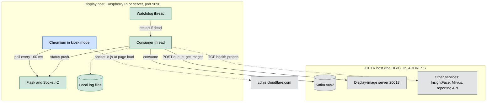
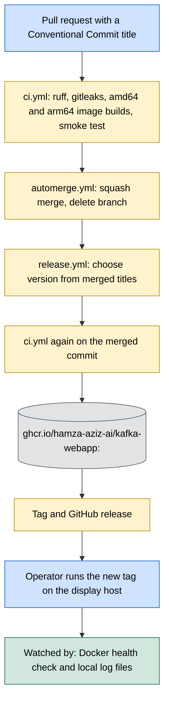
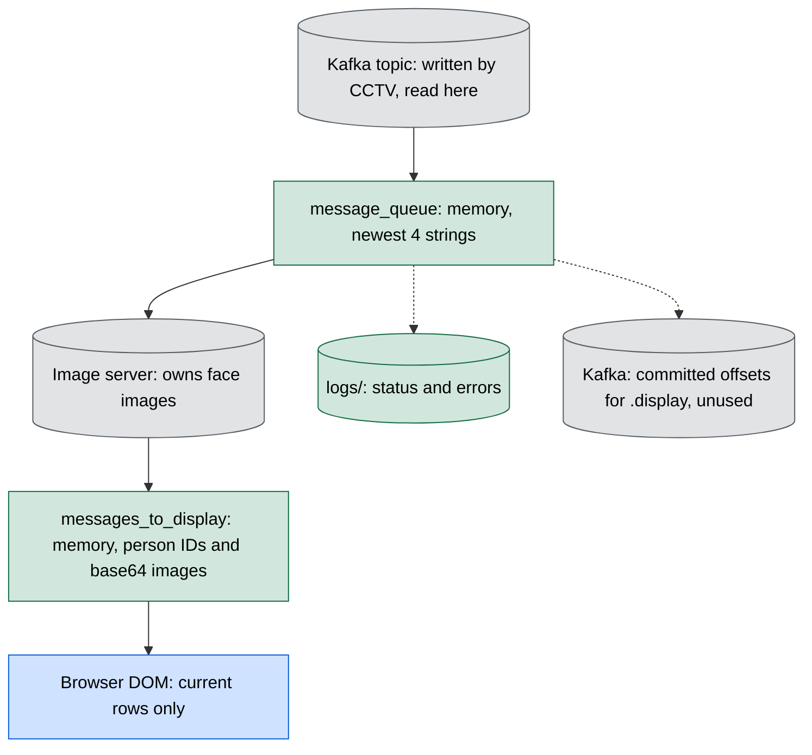

# ARCHITECTURE: what exists and who owns it

This is the detailed Solution Architecture. The overview is in [README.md](../README.md), and how execution moves is in [FLOW.md](FLOW.md).

**Checked against:** `main` at `0f05931` (release `v0.1.2`) with PR #5 (`7d2473e`), PR #6 (`03c3369`), PR #7 (`1c6cad9`) and the all-partitions change merged on top.

This system has no customers yet. It is being run through simulated real-world conditions before going to market, and "client" means a simulated client.

## Modules

| Module | Owns |
|---|---|
| `app.py` | The Flask and Socket.IO server, the consumer thread and its health checks, the watchdog thread, and the in-memory message state |
| `parameters.py` | All settings: addresses, ports, topic, consumer group, display size and timings, read from the environment where a value differs by host |
| `custom_logging.py` | The log file layout (`logs/<year>/<month>/raspberry.log`), daily rotation and the 31 day backup limit |
| `templates/index.html` | The display page: layout and theme, polling, and how long each status stays on screen |
| `static/fonts/` | Bundled IBM Plex Sans, under the licence in `OFL.txt`, so that a kiosk renders the same with no internet |
| `Dockerfile` | The image: pinned base, non-root `app` user, TCP health check on port 9090 |
| `test_partitions.py` | Broker-free checks of partition selection and the message queue. CI does not run it yet |
| `.github/workflows/` | `ci.yml` (lint, secrets, image build and smoke test), `automerge.yml` (merge and branch delete), `release.yml` (version, images, tag, release) |

## Colour legend

The three views share these colours.

| Colour | Meaning |
|---|---|
| Blue | People and browsers |
| Green | Code in this repo |
| Amber | GitHub automation |
| Grey | Outside this repo |

## A1. Runtime topology

What runs where, and what talks to what.

The app talks to only two services on the CCTV host: Kafka and the display-image server. It never calls the others; it only checks that their ports accept connections, because an attendance display should say the system is down when any part of it is. `PROJECT_SERVICES` sets that list exactly, and can name a host per service, so a display inside the CCTV stack can reach services that are not published on the host. Otherwise `PROJECT_SERVICES_PORT` narrows the default list. Both exist because older images crash on `host:port` in `PROJECT_SERVICES_PORT`, while they ignore `PROJECT_SERVICES`.

On a central host, each client's display must point at its own image server through `IMAGE_SERVER_ADDRESS`. In the CCTV stack that is `http://display-image-server:20013/post_images`. A display left on the wrong server would show another client's faces.

## A2. How a change reaches production and is watched there

- **Merge gate.** Green CI on the latest commit of a non-draft PR from this repo is the only gate. `automerge.yml` skips drafts and forks, and it runs from `main`, so a PR cannot rewrite the rule that merges it.
- **Versions.** `feat:` gives a minor release, `fix:` and `perf:` a patch, and `type!:` or a `BREAKING CHANGE` footer a major. Other titles, such as `docs:`, merge without a release.
- **Images first.** Images are pushed before the tag exists, so a release is never published without them. Images only have version tags, so there is no `latest`.
- **Deploy.** Nothing deploys automatically. An operator runs the new tag on each display host.
- **Watching.** There are no alerts or dashboards. The Docker health check only proves port 9090 accepts connections, so problems are found in `logs/` or on the screen itself.

## A3. Where each kind of data lives and who writes it

Details and trade-offs are in [DATA.md](DATA.md).

Person IDs and face images only pass through this app in memory. They are never written to disk here.

## Contract with the CCTV system

This app shows the recognition data the CCTV system sends, so the two must change together. The CCTV side confirmed this against its own code on 2026-10-31.

| Part | Contract |
|---|---|
| Topic | `<location>_<point>`, becoming `<client>.<location>_<point>` (with `owner.` for the owner) from CCTV decision D-036, step 3c |
| Partition | Camera number - 1, so `cctv-camera-3` goes to partition 2. The count only grows, when a camera is added |
| Person message | Value is the plain person ID, not a name and not JSON. Key is the camera name, `<location>_<point>_<camera>`. Only recognised matches are sent, one per person per camera per batch |
| Control message | `ERROR <camera>: <text>` or `SUCCESS <camera>: <text>`, sent by the CCTV producer for lighting and camera stream problems, on that camera's partition. The producer re-sends `ERROR` while the condition lasts: every 30 seconds for an inaccessible camera, and on every evaluation for low light. `SUCCESS` is sent once per recovery. This app keeps these itself and does not post them to the image server |
| `POST /post_images` | Body is `{"messages": [...]}`, person IDs only. The response is a list in request order with one single-key object per message: `{"<id>": "<base64 jpg>"}` |
| Unknown ID or missing image | Returns a 256x256 placeholder JPEG under the ID, never an error, so an unknown ID cannot be told from a known one by shape |
| Kafka login, from D-036, step 3c | `SASL_PLAINTEXT` with `SCRAM-SHA-512` on port 9092, as the `<client>_display` user, with Read and Describe on topics `<client>.*` and Read on groups `<client>.*`. `<topic>.display` fits the `<client>.` prefix. This app turns it on when `KAFKA_USERNAME` is set. `SASL_SSL` comes later through `KAFKA_SECURITY_PROTOCOL` |

**One screen per entry point by default.** The display reads every partition of its topic, so it shows all cameras at that point. `KAFKA_PARTITIONS` narrows it to chosen cameras, for one screen per camera.

## Trust boundaries

| Boundary | What crosses it | Control today |
|---|---|---|
| Network to port 9090 | Page, Socket.IO events | None: no auth, and `cors_allowed_origins="*"`. Anyone who can reach the port sees person IDs and faces |
| Kafka to the consumer | Message strings | SASL login when `KAFKA_USERNAME` is set, without encryption. Text is rendered with `textContent` |
| Image server to the consumer | JSON list of person IDs and images | Trusted network only. Rendered with `textContent` and a `data:` URL |
| CDN to the browser | `socket.io.js` | None: no Subresource Integrity check |

The threats behind these are in [THREAT.md](THREAT.md).

## Ownership of critical logic

| Logic | Where it lives |
|---|---|
| What counts as down, and when to announce it | `_consume_messages` with `NETWORK_FAIL_CHECK` |
| Camera `ERROR` and `SUCCESS` control messages | `update_camera_status` and the strip in `templates/index.html`. Their format is shared with the CCTV system |
| System status messages | `_consume_messages`, and `templates/index.html` for how long they stay on screen |
| The `Getting Started` wait | The text is duplicated in `app.py` and `templates/index.html`, so change both together |
| Client separation | `KAFKA_TOPIC`, `CONFLUENT_KAFKA_GROUP` and `IMAGE_SERVER_ADDRESS`, one set per display |
| Which cameras a display shows | `KAFKA_PARTITIONS` and `assign_new_partitions`. It must stay `assign()`, because displays share a group and `subscribe()` would split the partitions between them |
| Merge and release rules | `automerge.yml` and `release.yml` |

## Deployment

There are two ways to run it:

- **Docker (current).** `docker run` with the settings in the [README](../README.md#quick-start). The image is built for amd64 and arm64 and runs `python3 app.py` as a non-root user.
- **Raspberry Pi without Docker.** Two systemd services run the app and a Chromium kiosk at `http://localhost:9090`. See [SETUP-RASPBERRY-PI.md](SETUP-RASPBERRY-PI.md).

Both use the Flask development server, which is a known limit.
