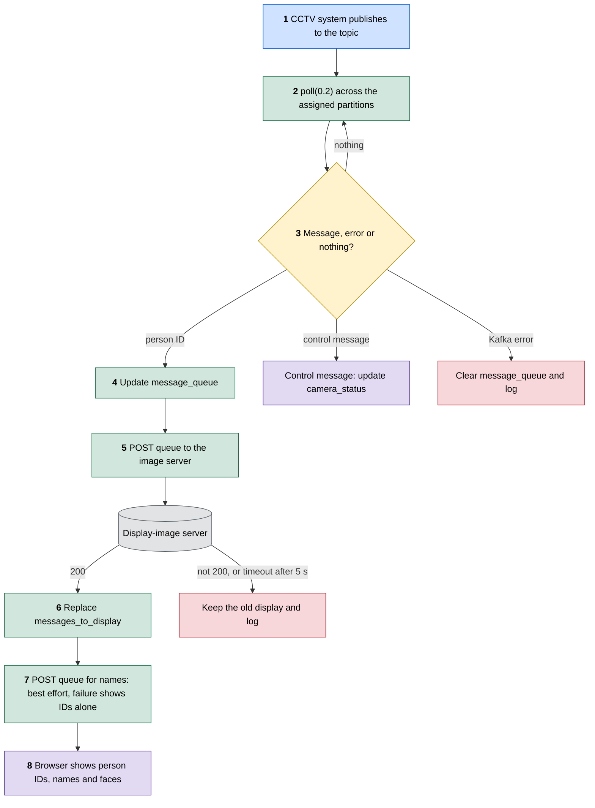
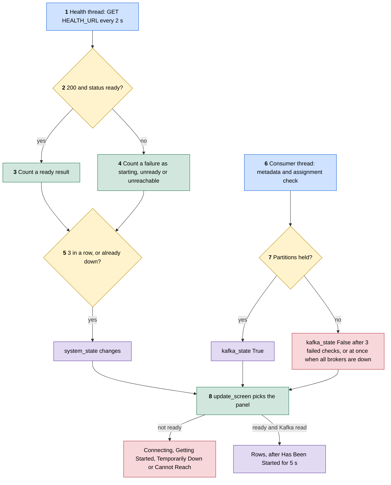
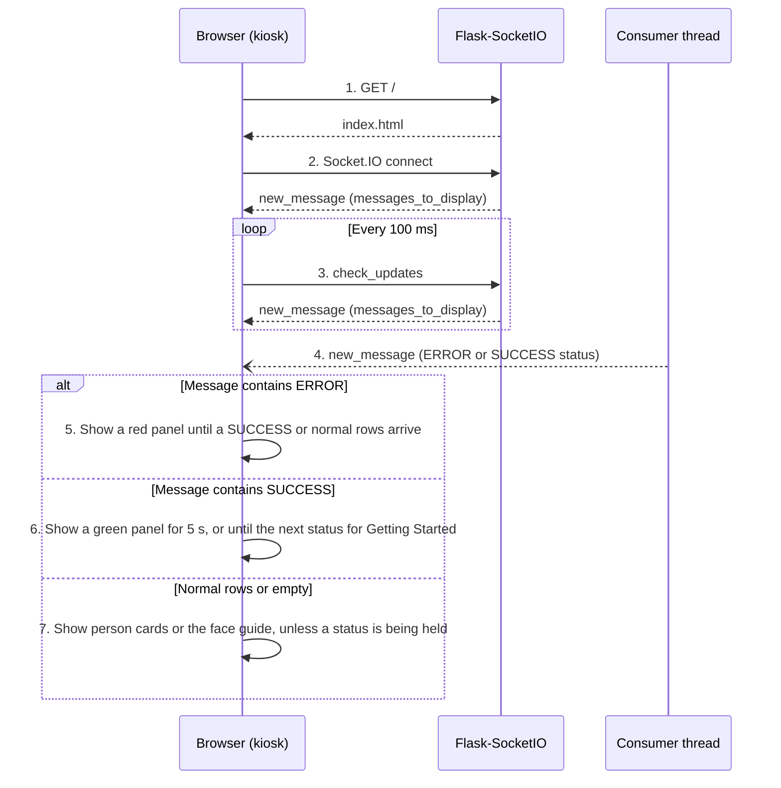
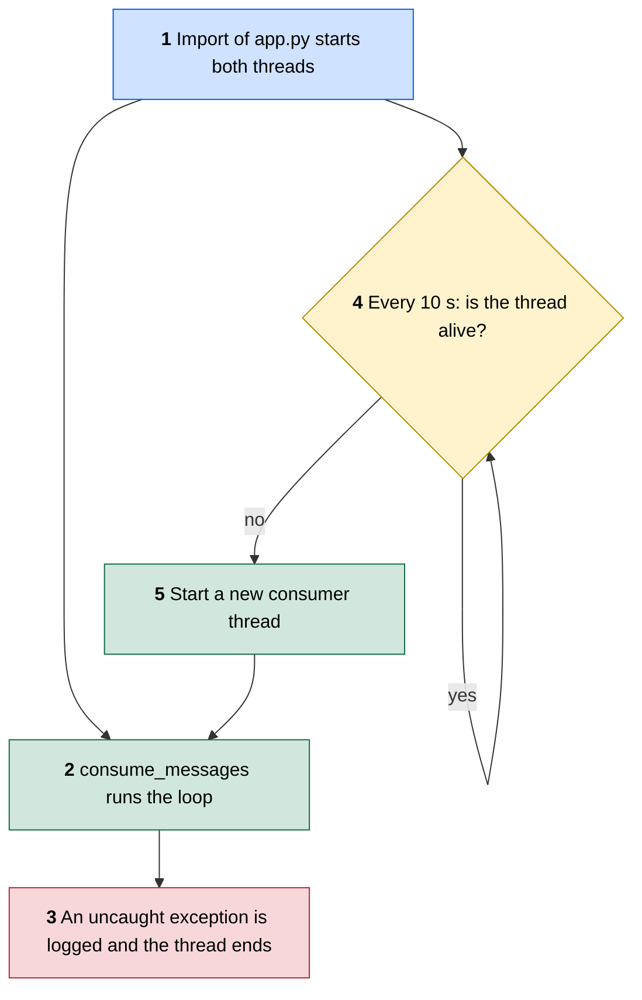

# FLOW: how execution travels

This is the detailed System Design. The overview is in [README.md](../README.md), and what exists and who owns it is in [ARCHITECTURE.md](ARCHITECTURE.md).

**Checked against:** `main` at `0c6df18` (release `v0.2.0`) with the all-cameras PR on top.

## How to read the diagrams

Flowcharts read top to bottom, and each colour has one meaning:

| Colour | Meaning |
|---|---|
| Blue | The way in |
| Green | A code step |
| Amber | A decision |
| Purple | An outcome someone can see on the display |
| Red | An error |
| Grey | A data store or outside service |

Sequence diagrams use solid arrows for requests, dashed arrows for answers, and alt boxes for branches. The numbers in each diagram match the numbered trace under it.

## F1. A recognition message reaches the screen

The path of one Kafka message, from the topic to a row on the display. All of it runs in the consumer thread except step 6, which runs when the browser asks.

1. **Publish.** The CCTV system sends one message per recognised person per camera per batch. The value is the plain person ID, the key is the camera name, and the CCTV system sends each camera to its own partition (partition = camera number - 1, so `cctv-camera-3` goes to partition 2). The topic is `KAFKA_TOPIC`, by default `maingate_entry`, and client topics are named `<client>.<location>_<point>`.
2. **Poll.** `consume_once` calls `kafka_consumer.poll(0.2)`. `assign_new_partitions` assigns every partition of the topic at `OFFSET_END`, or only those in `KAFKA_PARTITIONS`, so the display reads from the end and never replays old messages. Its group is `<topic>.display`, which only stores committed offsets, and nothing reads them.
3. **Branch.** No message returns to the top of the loop. A Kafka error clears `message_queue` and is logged.
4. **Queue.** A message starting with `ERROR ` or `SUCCESS ` is a control message. The CCTV producer sends these for camera lighting and stream problems, on that camera's own partition. It skips the queue, is not sent to the image server, and does not reset the idle timer: `update_camera_status` stores it in `camera_status` by camera, so that it can never hide a person row. An `ERROR` stays until that camera's `SUCCESS` arrives, or for `CAMERA_ERROR_SECONDS` (180) after the producer last repeated it, and a `SUCCESS` shows for `CAMERA_SUCCESS_SECONDS` (5). Any other message is added at the front if it is not already there, and the oldest is dropped once the queue holds `DISPLAY_LIST_SIZE` (4). Dropping duplicates is intended, so one person seen by several cameras or frames shows once.
5. **Ask for images.** `post_message_queue_and_get_images` posts `{"messages": message_queue}` to `IMAGE_SERVER_ADDRESS`. It uses `json=`, because FastAPI answers 422 without that `Content-Type`, and a 5 second `IMAGE_SERVER_TIMEOUT`, so a hung server cannot freeze this thread.
6. **Store.** On 200, the response body replaces `messages_to_display`: a list in request order with one single-key object per message. An unknown ID or missing image comes back as a placeholder JPEG under the ID, or as `null` once the CCTV side switches (D-017), so it looks like any other row. On any other status, a body that is not a list, or an exception, the current IDs replace it with `null` images, so they show as silhouettes and never as the rows from before, and the error type is logged. `last_update_time` is set in both cases.
7. **Ask for names.** `post_message_queue_and_get_names` then posts the same body to `NAME_SERVER_ADDRESS`, which is `IMAGE_SERVER_ADDRESS` with the last path segment changed to `/post_names`. A JSON object of ID to name replaces `names_to_display`, keeping only non-empty strings. A 404 from an older CCTV release, any other error, or a bad body empties it, so the page shows IDs alone and the faces are never held back. Errors log only their type, because a message could carry a name. See D-015.
8. **Show.** The display picks up the new value on its next poll, which is flow F3.

## F2. Readiness, outages and recovery

Two checks decide what the display says, and neither blocks reading Kafka. The health thread asks the CCTV producer whether the attendance system works. The consumer thread checks the display's own path to Kafka, which the producer cannot see. Each change needs `HEALTH_STREAK` (3) results in a row, so one slow check never flashes a panel (D-021).

1. **Ask.** `watch_health` calls `read_health` on a fixed 2 second beat (`HEALTH_INTERVAL`), timed with the monotonic clock so it does not drift. Each request has a 1.5 second limit (`HEALTH_TIMEOUT`) and is closed by its `with` block. The limit does not cover the DNS lookup, which took about 3 seconds for a stopped container's name, so a check can overrun its slot; the next one then starts at once. If no result is recorded for `HEALTH_STALE` (7.5) seconds, `check_health_stale` in the consumer thread counts the system as unreachable, so a stuck or dead health thread can never leave the screen on ready.
2. **Read.** Only a 200 with `{"status": "ready"}` is ready. A body with `"status": "starting"` is starting. Any other answer, including a 404 from a CCTV release without the endpoint, is unready. No answer, a refused connection or a timeout is unreachable. The producer's reasons, such as `milvus_unavailable`, are logged when the state changes, and anything that is not a short lowercase code is dropped first.
3. **Count up.** `record_health` keeps `health_streak`, positive for ready results in a row.
4. **Count down.** It goes negative for failures in a row.
5. **Decide.** `system_state` starts as `None` and changes only after 3 results in a row agree. Once the system is down, each failed result updates it at once, so `Getting Started` follows `Temporarily Down` as soon as the producer restarts, and ready still needs 3 in a row.
6. **Kafka.** `check_kafka` runs `assign_new_partitions`, which asks Kafka for the topic's partitions with a 5 second limit and assigns new ones at `OFFSET_END`. While Kafka is usable it runs every `KAFKA_PARTITION_CHECK_INTERVAL` (60) seconds, and every 2 seconds while it is not. A Kafka error during `poll` sets `kafka_suspect`, so the next pass checks at once. An `_ALL_BROKERS_DOWN`, authentication or fatal error from librdkafka's `error_cb` also sets `kafka_state` to `False` at once, because librdkafka reports these only after trying every broker. Waiting for 3 failed checks of up to 5 seconds each let the idle screen show for 6 seconds in a simulation, and the owner chose the immediate panel (D-021). Neither creating a consumer nor polling one proves the broker answers, so only this check counts.
7. **Assigned.** The display's path is usable when the topic reads without an error and it holds at least one partition. When it becomes usable again, each camera `ERROR` gets a fresh `CAMERA_ERROR_SECONDS`, because nothing could be repeated while Kafka was out of reach. After 3 failed checks in a row, `kafka_state` is `False`. If `poll` raises, the consumer is closed and the next pass makes a new one.
8. **Show.** `update_screen` runs every pass and changes the screen only when the wanted panel changes, clearing the queue, rows and names each time, so rows from before a panel never return after it. Until the first verdict, or while the system is ready but Kafka has not been checked, it is the grey `Connecting` panel. Then a starting system shows green `Getting Started. Please Wait`, an unready one red `Temporarily Down`, and an unreachable one, or a ready one whose Kafka path is gone, red `Cannot Reach the Facial Recognition Attendance System`. Leaving any panel but `Connecting` shows `Has Been Started. Please Resume Attendance` for 5 seconds. While a panel shows, the consumer thread still reads camera `ERROR` and `SUCCESS` messages, but drops person messages, which would come back as stale rows for attendance that may not have been kept.

Every pass then ends with the idle clear: after `STATUS_THRESHOLD` (15) seconds without an update, the rows are cleared and the whole state goes to the browser.

## F3. The display page

The page loads once, then polls over Socket.IO. Person rows and the camera status strip arrive through this poll. System status messages arrive as pushes from flow F2.

1. **Load.** `index` renders `templates/index.html`. The page loads `socket.io.js` from `cdnjs.cloudflare.com`, so a kiosk with no internet gets no live updates.
2. **Connect.** The page connects to its own origin, so the same page works over plain HTTP and behind an HTTPS proxy. `handle_connect` sends the current value straight away.
3. **Poll.** `handle_check_updates` answers every 100 ms with `current_state()`: a status in force from `display_status`, or else the whole of `messages_to_display`, including base64 images, plus `camera_status`, which the page scrolls as amber and green chips in a one-line marquee at the bottom of the screen, redrawing only when the list changes so the scroll does not restart. It also carries `names`, and the page shows a person's name in smaller text under the ID, wrapped to two lines and then cut with an ellipsis, or the ID alone when there is no name. A person whose image is `null` or empty gets a silhouette in a colour from the person's ID, and never the same colour as another card on screen (D-017). The page keeps no state of its own and draws exactly what each reply says, so a refresh shows the same screen. Each reply resets the page's 15 second timer, which fires only if the server stops answering. Then, and whenever the socket disconnects, the page shows the red `Network Issue` panel, never the idle face guide (D-019).
4. **Push.** `push_status` sends each status at once with `socketio.emit` and keeps it in `display_status` with its end time: a red status and `Getting Started` last until the next one, and `Has Been Started` 5 seconds. Every poll, every new connection and the page itself, which the server renders with the state in it, carry the status for the time it has left, so a refresh resumes it. From start until the first checks pass, the status is a grey `Connecting to the Facial Recognition Attendance System` panel. Camera chips keep their own 5 second expiry in `camera_status`, and are hidden while any status is in force, because no camera can be checked while the system itself is down, starting or out of reach. They return when the status ends. The consumer thread keeps reading them while the system is down, and when the display's own Kafka path comes back each camera error gets a fresh 180 seconds, because nothing was read while it was gone; a camera that recovered in the meantime drops off when its error is not repeated (D-020, D-021).
5. **Error.** An ERROR fills the content area as a red panel until a SUCCESS or normal rows arrive.
6. **Success.** A SUCCESS fills the content area as a green panel, for 5 seconds or, for `Getting Started`, until the next status. It has no progress bar, because starting has no fixed length.
7. **Rows.** Each person is a card in a grid of two fixed rows, so a card is the same size whether one person or four are showing, with the newest top left and marked in teal. The others run clockwise, so the oldest sits bottom left. On each change, a card that stays glides from its old place to its new one, a new card fades in, and a card that leaves fades out where it stood, all in 300 ms. A browser set to reduce motion jumps instead (D-018). Person IDs are written with `textContent`. Each name is shrunk to fit one line, down to half size, then wraps after an underscore, and breaks mid-word only when one part still does not fit (D-014). Each image is set from a base64 `data:` URL. With no rows the page shows a face guide. The server repeats itself every 100 ms, so the page redraws only when the content changes.

## F4. The consumer thread dies

The consumer loop runs in a daemon thread, and a separate watchdog thread restarts it if it dies.

1. **Start.** The threads start when `app.py` is imported, under both `python3 app.py` and `flask run`.
2. **Run.** `consume_messages` calls `consume_once` in a loop.
3. **Crash.** The wrapper logs `Consumer thread crashed` and returns, which ends the thread.
4. **Watch.** `monitor_consumer_thread` checks `is_alive()` every 10 seconds, so it catches a dead thread and not a stuck one.
5. **Restart.** A new thread runs the same loop and keeps the module-level state, including the readiness and Kafka state. The health thread has no watchdog: if it stops, `check_health_stale` shows `Cannot Reach` after 7.5 seconds.
