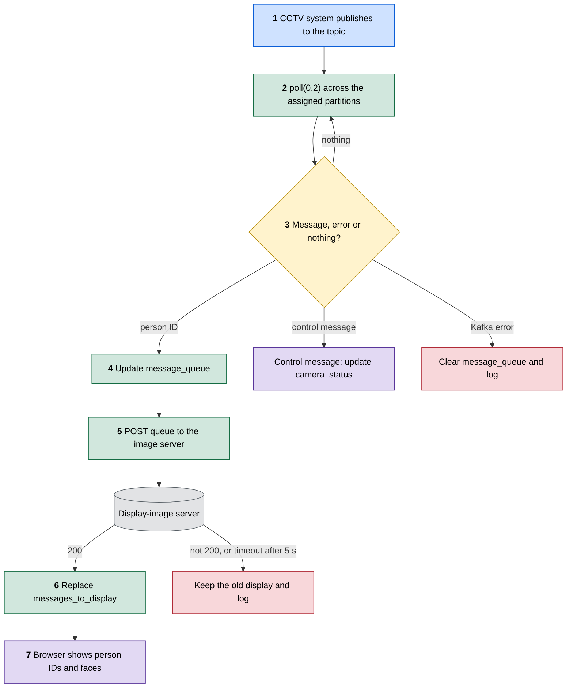
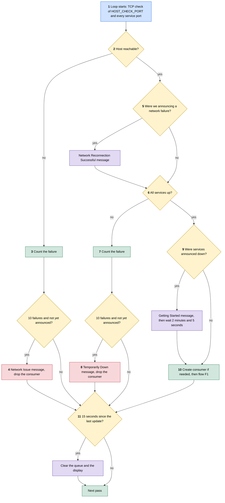
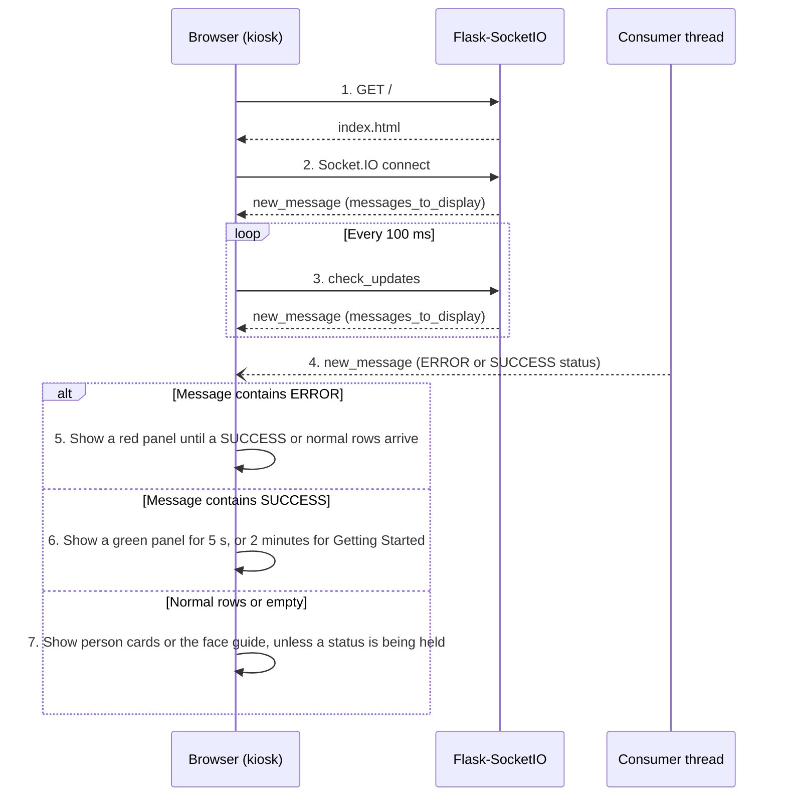
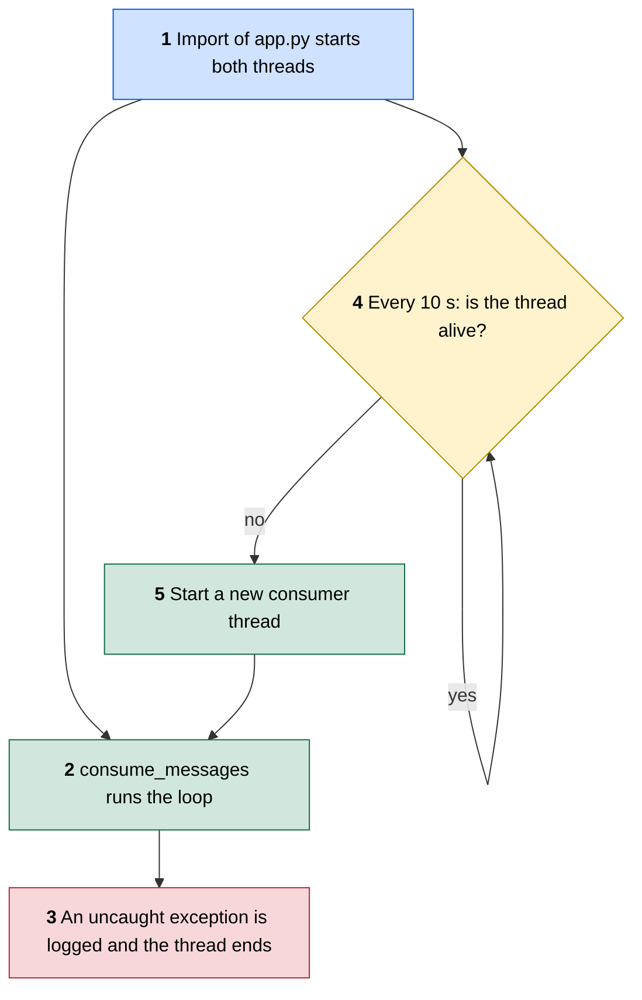

# FLOW: how execution travels

This is the detailed System Design. The overview is in [README.md](../README.md), and what exists and who owns it is in [ARCHITECTURE.md](ARCHITECTURE.md).

**Checked against:** `main` at `0f05931` (release `v0.1.2`) with PR #5 (`7d2473e`), PR #6 (`03c3369`), PR #7 (`1c6cad9`) and the all-partitions change merged on top.

## How to read the diagrams

Flowcharts read top to bottom, and each colour has one meaning:

| Colour | Meaning |
|---|---|
| Blue | The way in |
| Green | A code step |
| Amber | A decision |
| Purple | An outcome someone can see on the display |
| Red | An error |
| Grey | A data store or outside service |

Sequence diagrams use solid arrows for requests, dashed arrows for answers, and alt boxes for branches. The numbers in each diagram match the numbered trace under it.

## F1. A recognition message reaches the screen

The path of one Kafka message, from the topic to a row on the display. All of it runs in the consumer thread except step 6, which runs when the browser asks.

1. **Publish.** The CCTV system sends one message per recognised person per camera per batch. The value is the plain person ID, the key is the camera name, and the CCTV system sends each camera to its own partition (partition = camera number - 1, so `cctv-camera-3` goes to partition 2). The topic is `KAFKA_TOPIC`, by default `maingate_entry`, and client topics are named `<client>.<location>_<point>`.
2. **Poll.** `_consume_messages` calls `kafka_consumer.poll(0.2)`. `assign_new_partitions` assigns every partition of the topic at `OFFSET_END`, or only those in `KAFKA_PARTITIONS`, so the display reads from the end and never replays old messages. Its group is `<topic>.display`, which only stores committed offsets, and nothing reads them.
3. **Branch.** No message returns to the top of the loop. A Kafka error clears `message_queue` and is logged.
4. **Queue.** A message starting with `ERROR ` or `SUCCESS ` is a control message. The CCTV producer sends these for camera lighting and stream problems, on that camera's own partition. It skips the queue, is not sent to the image server, and does not reset the idle timer: `update_camera_status` stores it in `camera_status` by camera, so that it can never hide a person row. An `ERROR` stays until that camera's `SUCCESS` arrives, and a `SUCCESS` shows for `CAMERA_SUCCESS_SECONDS` (5). Any other message is added at the front if it is not already there, and the oldest is dropped once the queue holds `DISPLAY_LIST_SIZE` (4). Dropping duplicates is intended, so one person seen by several cameras or frames shows once.
5. **Ask for images.** `post_message_queue_and_get_images` posts `{"messages": message_queue}` to `IMAGE_SERVER_ADDRESS`. It uses `json=`, because FastAPI answers 422 without that `Content-Type`, and a 5 second `IMAGE_SERVER_TIMEOUT`, so a hung server cannot freeze this thread.
6. **Store.** On 200, the response body replaces `messages_to_display`: a list in request order with one single-key object per message. An unknown ID or missing image comes back as a placeholder JPEG under the ID, so it looks like any other row. On any other status or an exception, the old value stays and the problem is logged. `last_update_time` is set in both cases.
7. **Show.** The display picks up the new value on its next poll, which is flow F3.

## F2. Health checks, outages and recovery

Every pass of the consumer loop starts here, before any Kafka work. This flow decides what the display says when something is down. Failure counts must reach `NETWORK_FAIL_CHECK` (10), so a brief drop does not show an error.

1. **Probe.** `ping_server` opens a TCP connection with a 0.5 second timeout, first to `HOST_CHECK_PORT` (22), then to each entry in `PROJECT_SERVICES` until one fails. That is up to 7 connections per pass with the default list. `PROJECT_SERVICES` comes from the variable of that name, which can name a host for each service, or else from the ports in `PROJECT_SERVICES_PORT` on `IP_ADDRESS`. A probe only proves a port accepts connections, not that the service behind it works.
2. **Host check.** The result of `HOST_CHECK_PORT` alone decides whether the network is up.
3. **Count.** `server_ping_fail` goes up by one. If probes time out, 10 passes take about 10 seconds. If connections are refused at once, they take far less.
4. **Announce once.** `message_queue` and `messages_to_display` are cleared, the ERROR `Network Issue: Unable to Connect to the Server` is emitted once, and the Kafka consumer reference is dropped.
5. **Recover.** Once the host answers again, the queues are cleared and `Network Reconnection Successful` is emitted once.
6. **Services check.** Every entry in `PROJECT_SERVICES` must accept a connection.
7. **Count.** `services_ping_fail` goes up by one.
8. **Announce once.** The queues are cleared, the ERROR `Facial Recognition System Temporarily Down for Maintenance or Due to an Unexpected Issue` is emitted once, and the consumer reference is dropped.
9. **Restart wait.** After a services outage, the SUCCESS `Getting Started` message is emitted and the thread sleeps for 2 minutes, then emits `Has Been Started` and sleeps 5 more seconds. Nothing is consumed during this wait. `templates/index.html` matches the `Getting Started` text exactly to hold it for 2 minutes, so change both together.
10. **Consume.** A consumer is created if there is none, which also empties `camera_status`, because a new consumer starts at `OFFSET_END` and may have missed a `SUCCESS`. If creation fails, the thread waits 5 seconds and starts the next pass. Every `KAFKA_PARTITION_CHECK_INTERVAL` (60) seconds, `assign_new_partitions` reads the topic's partitions and adds any new ones, because the count grows when a camera is added. It uses `incremental_assign`, which leaves partitions already being read alone. A partition listed in `KAFKA_PARTITIONS` that does not exist yet logs a warning and is picked up when it appears. A failed check is retried after 5 seconds. If polling raises, the consumer reference is dropped and the next pass makes a new one.
11. **Idle clear.** Every pass ends here. After `STATUS_THRESHOLD` (15) seconds without an update, both lists are cleared and an empty message goes to the browser.

## F3. The display page

The page loads once, then polls over Socket.IO. Person rows and the camera status strip arrive through this poll. System status messages arrive as pushes from flow F2.

1. **Load.** `index` renders `templates/index.html`. The page loads `socket.io.js` from `cdnjs.cloudflare.com`, so a kiosk with no internet gets no live updates.
2. **Connect.** `handle_connect` sends the current value straight away.
3. **Poll.** `handle_check_updates` answers every 100 ms with the whole of `messages_to_display`, including base64 images, plus `camera_status`, which the page draws as amber and green chips under the header. Each reply resets the page's own 15 second inactivity timer, so that timer only fires if the socket stops answering.
4. **Push.** Status messages use `socketio.emit` once and are not stored in `messages_to_display`, so a page that loads after the push does not see them.
5. **Error.** An ERROR fills the content area as a red panel until a SUCCESS or normal rows arrive.
6. **Success.** A SUCCESS fills the content area as a green panel for 5 seconds, or for 2 minutes with a progress bar for the `Getting Started` text.
7. **Rows.** Each person is a card, with the newest first and marked in teal. Person IDs are written with `textContent`, and each image is set from a base64 `data:` URL. With no rows the page shows a face guide. The server repeats itself every 100 ms, so the page redraws only when the content changes, which also stops the progress bar restarting.

## F4. The consumer thread dies

The consumer loop runs in a daemon thread, and a separate watchdog thread restarts it if it dies.

1. **Start.** The threads start when `app.py` is imported, under both `python3 app.py` and `flask run`.
2. **Run.** `consume_messages` wraps `_consume_messages`.
3. **Crash.** The wrapper logs `Consumer thread crashed` and returns, which ends the thread.
4. **Watch.** `monitor_consumer_thread` checks `is_alive()` every 10 seconds, so it catches a dead thread and not a stuck one.
5. **Restart.** A new thread runs the same loop and keeps the module-level state, including the announcement flags.
